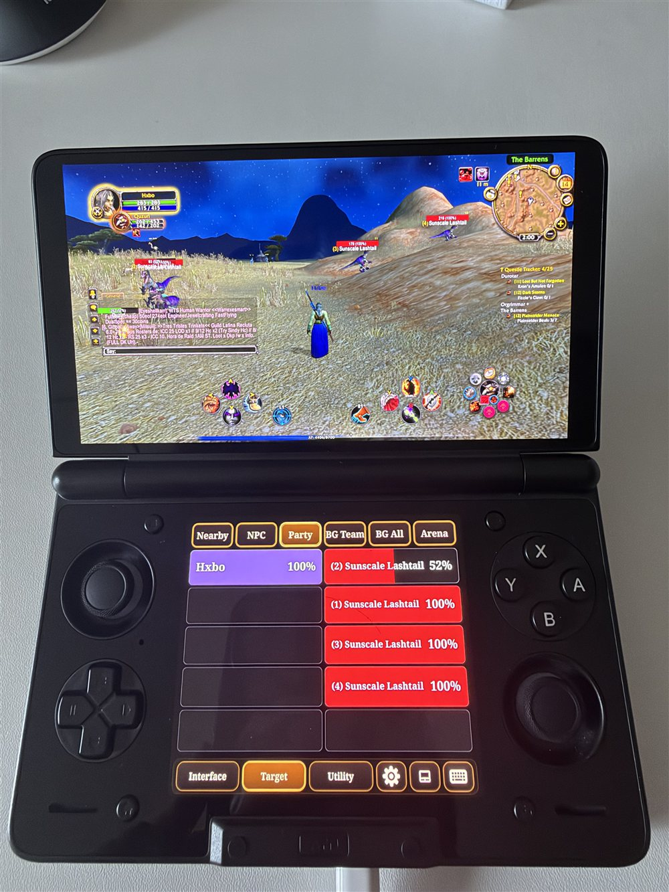

# Warmane on AYN Thor

<p align="center">
  <a href="https://buymeacoffee.com/nichon"></a>
  <br>
  If you like the app, please consider <a href="https://buymeacoffee.com/nichon">buying me a coffee</a>.
</p>

---

An Android launcher for playing [Warmane](https://www.warmane.com) (World of Warcraft
3.3.5a) on the AYN Thor.

This is a fork of [WoW Mobile](https://github.com/marcocastignoli/wow-mobile), and uses the
touch screen controls of the [AYN Thor WoW Launcher](https://github.com/wyattabuntjer/AYN-Thor-WoW-Launcher).

**[Download here](https://github.com/nicho-n/warmane-ayn-thor/releases/latest/download/warmane-ayn-thor.apk)**

<p align="center">
  
</p>

## Features

- **Touch targeting:** a page on the bottom screen lists nearby units, your party, your
  raid (Raid Heal mode), battleground or arena players; tap one to target it.
- **Touch screen controls:** button pages, a keyboard and a trackpad on the bottom screen,
  with the game on the top screen.
- **Opinionated console controls:** a remappable ConsolePort controller layout, plus **A** to
  play, enter the world and log in, and the **D-pad** to pick a character.

Also: an Update button next to Play when a new version is out (with what's new), optional
auto-login (password encrypted on the device), an optional touch-controls overlay on the
game screen, and Box64 0.4.5, which Warmane accepts.

## Default controller layout

Characters that don't have ConsolePort bindings yet start with this layout. Change it in
ConsolePort's binding menu; `/thor defaults` puts it back on the current character.

Buttons are named by the letters printed on the Thor (X top, A right, B bottom, Y left),
with the Thor's controller mode set to **Standard** (its default).

ABXY and the D-pad are action bar buttons; holding L2, R2 or both switches to another
set of action bar buttons. Other buttons:

| Button | Action |
|---|---|
| A / B / X / Y | Action bar |
| D-pad | Action bar |
| L1 | Target nearest enemy |
| R1 | Jump |
| Select | Target nearest friend |
| Select + L2 | World map |
| Start | Interact with the unit under the pointer |
| Start + L2 | Game menu |
| Start + R2 | Raid cursor |
| Start + L2 + R2 | Open chat |
| D-pad up + L2 | Camera zoom in |
| D-pad down + L2 | Camera zoom out |
| A + L2 + R2 | Open all bags |
| B + L2 + R2 | Utility ring |
| Left stick | Move |
| Right stick | Camera; R3 switches it to moving the pointer, L3 clicks |

## Requirements

- AYN Thor. Other Android devices may run it, but the bottom-screen features need the
  Thor's second screen.
- Your own World of Warcraft 3.3.5a (build 12340) client. No game files are included.
- A Warmane account.

## Setup

1. Install the APK ([download](https://github.com/nicho-n/warmane-ayn-thor/releases/latest/download/warmane-ayn-thor.apk)), or build it (see below).
2. Open the app and pick the folder that contains `Wow.exe`. The app lists the addons it
   will install and, if you continue, first zips your `Interface/AddOns` folder into the
   game folder as `AddOns-backup-<date>.zip`.
3. Press **Play**.

A new game folder is set up for Warmane (`logon.warmane.com`) at 1920x1080. Realm,
resolution, account name and auto-login can be changed in **WoW Settings**. With the
account name set, the controller is set up before your first login.

## Addons

The app installs these. Only their own folders are replaced; other addons are left alone.

| Addon | Installed | What it does |
|---|---|---|
| `ThorControls` | Always | Sets up ConsolePort for the controller layout and the right-stick camera; Thor layout fixes (`/thor`). Stops the frame stalls on each cast (ConsolePort's action buttons each ran a native cooldown sweep every global cooldown) and keeps the cooldown numbers exact. |
| `WoWMobileLink` | Always | Sends unit info to the touch targeting page. |
| ConsolePortLK | Always | Controller UI. Replaces any other ConsolePort. |
| NotPlater | If missing | Nameplates. Required for touch targeting. |

`ThorControls` and `WoWMobileLink` are updated on Play when the app has a newer version.
Your ConsolePort bindings are kept. If WoW Imito's addons are installed, they're moved to
`Interface/AddOns-disabled`.

## Building

```
./gradlew assembleRelease
```

Requires JDK 17, Android SDK (platform 34), NDK 24.0.8215888 and CMake 3.22.1.
Release signing reads `~/.wow-mobile-secrets/keystore.properties`
(`storeFile`/`storePassword`/`keyAlias`/`keyPassword`); without it the release
build is unsigned.

## Credits

- [WoW Mobile](https://github.com/marcocastignoli/wow-mobile) by marcocastignoli: the app
  this is forked from.
- [AYN Thor WoW Launcher](https://github.com/wyattabuntjer/AYN-Thor-WoW-Launcher) by
  wyattabuntjer: the bottom-screen pad is ported from it.
- [WoW Imito](https://github.com/MrAnonymz/WoW-Imito) by MrAnonymz: original inspiration.
- [Winlator](https://github.com/brunodev85/winlator) by brunodev85: the Wine + Box64
  engine.
- [Box64](https://github.com/ptitSeb/box64) by ptitSeb and contributors.
- [ConsolePortLK](https://github.com/leoaviana/ConsolePortLK) by leoaviana: included.
- [NotPlater](https://github.com/RichSteini/NotPlater) by RichSteini: bundled (MIT).

## License

This fork is distributed under the GPL-3 (see `COPYING`): it contains the AYN Thor WoW
Launcher's GPL-3 code. Winlator and WoW Mobile are LGPL-2.1 (see `LICENSE`). Bundled
addons keep their own licenses. Box64 source details:
`app/src/main/assets/box64/BOX64-0.4.5-SOURCE.txt`.

World of Warcraft is a trademark of Blizzard Entertainment. This project is not
affiliated with Blizzard Entertainment, Warmane, WoW Imito or AYN.
